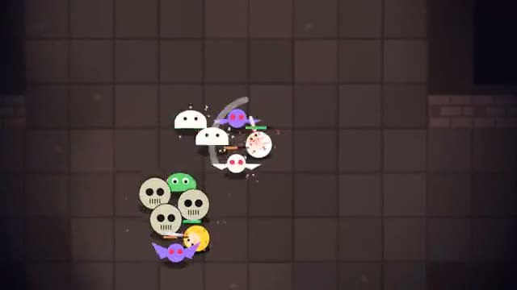

# Dungeon Crawl

Clear it room by room. Loot as a team. A multiplayer starter game from [Multiplayer Agent](https://multiplayeragent.com): 2D, co-op, 1–4 players, with AI companions that fill empty seats.

## How it plays

Each floor is a chain of rooms full of monsters. Clear a room to open the next door, grab the loot before your friends do, and find the stairs to go deeper. Swords add damage, shields add armor, hearts heal and gems are gold. If the whole party is down at once, the run ends.

**Controls:** WASD or arrows and Space, or the thumb stick and Attack button.

## Make it yours in the Game Builder

Open the [Game Builder](https://multiplayeragent.com), choose **Start from a starter game** and pick Dungeon Crawl. It opens as version 1 in your studio, ready to play and publish. Then ask for changes, for example:

- Add a mage and an archer class
- Add a shop between floors
- Add a boss on floor 5

## Run it yourself

1. Get a free publishable key (`pk_…`) at [multiplayeragent.com](https://multiplayeragent.com).
2. In `index.html`, put it in place of `pk_REPLACE_ME` in the `MP_CONNECT` block.
3. Open `index.html` in a browser. No build step and no server needed.

Without a key it still runs, offline with AI companions.

## How it is built

- One `index.html`. The comment at the top of the script maps the code and explains the multiplayer.
- **Host-run rules:** The host's browser runs the monsters, the loot drops and the room clears; if it leaves, the next player takes over.
- **Leaderboard:** The deepest floor each player reached.
- **Bots:** AI companions fight beside you until enough people join.
- **Live sync:** Everyone sees the same dungeon, monsters and swings as they happen.
- `?attract` runs it offline with AI companions only. The preview video is recorded from it.

## License

MIT.
